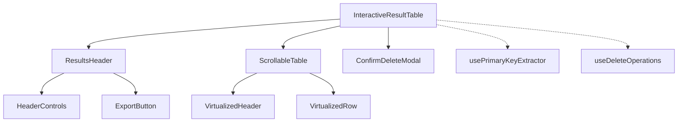

# 📊 ResultadosQueryComponent · InteractiveResultTable

O componente **`InteractiveResultTable`** é o **orquestrador visual e operacional dos resultados de consultas SQL** no frontend do MustaInf.

Ele vai além da exibição de linhas e colunas em tabela: ele gerencia a paginação contínua e eficiente por cursor (*keyset pagination*), seleção individual e em lote de registros, extração e resolução de chaves primárias (*Primary Keys*) para exclusão segura, clique para inspeção/edição e integração completa com modais e indicadores de status.

---

## 🏗️ 1. Arquitetura e Componentes Filhos

A estrutura de apresentação e lógica é desacoplada nas seguintes camadas:



### Componentes da Pasta

| Ficheiro | Responsabilidade |
| :--- | :--- |
| **[`InteractiveResultTable.tsx`](./InteractiveResultTable.tsx)** | Componente principal que gerencia estados de seleção, paginação, confirmações e coordena os subcomponentes. |
| **[`ScrollableTable.tsx`](./ScrollableTable.tsx)** | Tabela scrollável de alta performance com suporte a scroll infinito, virtualização, ordenação em memória e filtragem. |
| **[`ResultsHeader.tsx`](./ResultsHeader.tsx)** | Cabeçalho superior contendo contadores de linhas, botão para modo de seleção, botões de exclusão e menu adaptativo para mobile. |
| **[`HeaderControls.tsx`](./HeaderControls.tsx)** | Barra de controle com busca rápida e menu para ocultar/exibir colunas dinamicamente. |
| **[`VirtualizedHeader.tsx`](./VirtualizedHeader.tsx)** | Cabeçalhos das colunas com botões de ordenação (ASC/DESC/NONE) e checkbox "selecionar todos". |
| **[`VirtualizedRow.tsx`](./VirtualizedRow.tsx)** | Renderização das linhas com cálculo de larguras por tipo, destaque ao passar o mouse e suporte a clique. |
| **[`ExportButton.tsx`](./ExportButton.tsx)** | Opções de exportação dos resultados (CSV, JSON, Excel, etc.). |
| **[`SelectTablesToFetchModal.tsx`](./SelectTablesToFetchModal.tsx)** | Modal disparado em queries com múltiplos `JOINs` para o usuário escolher qual tabela da relação deseja manipular. |
| **[`types.ts`](./types.ts)** | Definições de tipos TypeScript compartilhados (`ConfirmDeleteModalType`, `PayloadDeleteRow`, etc.). |
| **[`funcs.tsx`](./funcs.tsx)** | Utilitários auxiliares de manipulação e formatação de dados. |
| **[`index.ts`](./index.ts)** | Ponto de entrada unificado que exporta o `InteractiveResultTable` como `default` e os submódulos como nomeados. |

---

## ⚙️ 2. Principais Responsabilidades e Mecanismos

### A. Formatação Inteligente de Cabeçalhos (`headers`)
- Mapeia as colunas retornadas em `queryResults.preview` cruzando com os metadados de esquema (`columnsInfo`).
- Descobre o **tipo de cada coluna** (ex: `integer`, `varchar`, `date`, `id`).
- Cria links automáticos de navegação para campos identificadores:
  ```typescript
  redirectUrl: tipo === "id" || col.toLowerCase().includes("_id")
    ? `/detalhes/${info?.table}/${col}`
    : undefined
  ```

### B. Paginação Híbrida: Cursor Keyset com Fallback de Offset (`carregarMaisLinhas`)
- Em vez de depender apenas de `OFFSET` tradicional ou ficar restrito a SQL simples, adota **paginação híbrida inteligente**:
  1. **NoSQL (MongoDB)**: Prioriza automaticamente a chave `_id` como cursor indexado ultra-rápido (`$gt: ObjectId(...)`); se não houver cursor, utiliza `skip(offset)` e `limit(limit)` graciosamente.
  2. **Oracle Database**: Suporte a sintaxes de paginação Oracle (`ROWNUM <= offset + max_rows WHERE rnum > offset`) com resolução de colunas insensível a maiúsculas/minúsculas (*case-insensitive*) em `valueOfRow`.
  3. **Demais SQLs (Postgres, MySQL, SQLite, MSSQL)**: Paginação por keyset `WHERE ordem > cursor` O(1) com fallback automático por `OFFSET` caso a query não tenha coluna ordenável única.
  4. **Proteção contra concorrência e duplicados**: Flags `loadingMoreRef` e `hasMoreRef` impedem requisições redundantes, e a mescla de dados desduplica itens por chave identificadora antes de atualizar a tabela.

### C. Gestão de Seleção e Ações de Linha
- **Modo Inspeção (`isSelectionMode = false`)**: O clique em qualquer linha aciona `handleRowClick`, que identifica a tabela associada e notifica o componente pai via `setSelectedRow` para abrir drawers ou modais de edição.
- **Modo Seleção (`isSelectionMode = true`)**: O clique alterna a seleção das linhas em um `Set<number>`. Disponibiliza:
  - Selecionar todos os registros (`selectAll`).
  - Limpar seleção (`clearSelection`).
  - Eliminar registros selecionados em lote.

### D. Exclusão Segura com Resolução de Primary Keys
- Utiliza o hook `usePrimaryKeyExtractor(columnsInfo)` para inspecionar os registros selecionados e encontrar as chaves primárias verdadeiras no banco de dados.
- **Tratamento de Queries Simples vs Queries Complexas (JOINs)**:
  - Se a consulta envolver apenas **1 tabela**, solicita confirmação de exclusão direta.
  - Se a consulta envolver **múltiplas tabelas (JOINs)**, abre o modal de seleção de tabela para garantir que o usuário escolha conscientemente a entidade afetada.
- As operações são executadas de forma assíncrona com exibição de barra de progresso em tempo real através do hook `useDeleteOperations()`.

---

## 📋 3. Principais Propriedades (Props)

| Prop | Tipo | Obrigatório | Descrição |
| :--- | :--- | :---: | :--- |
| **`queryResults`** | `QueryResultType` | Sim | Objeto contendo os dados da consulta (`preview`, `columns`, `QueryPayload`, `totalResults`). |
| **`columnsInfo`** | `MetadataTableResponse[]` | Não | Metadados com tipos de dados, chaves primárias e estruturas das tabelas. |
| **`setQueryResults`** | `(value: QueryResultType \| null) => void` | Sim | Função para atualizar os dados de resultado (usada após scroll ou exclusão). |
| **`setSelectedRow`** | `(row: SelectedRow) => void` | Não | Callback acionado ao clicar em uma linha no modo de inspeção. |
| **`selectedRow`** | `SelectedRow \| null` | Não | Linha atualmente selecionada para inspeção/edição. |
| **`modalFetchOpen`** | `boolean` | Sim | Controla a visibilidade do modal de seleção de tabelas para consultas com JOIN. |
| **`setModalFetchOpen`**| `(t: boolean) => void` | Sim | Alterna a visibilidade do modal de seleção de tabelas. |
| **`optionModalTable`** | `string` | Não | Tipo de operação a ser executada pelo modal de tabelas. |
| **`setOptionModalTable`**| `(s: string) => void` | Sim | Define o tipo de operação para o modal de tabelas. |
| **`responseModal`** | `string[]` | Não | Tabelas selecionadas pelo usuário no modal de resolução. |
| **`setResponseModal`** | `(r?: string[]) => void` | Sim | Atualiza as tabelas selecionadas para a operação. |

---

## 🚀 4. Como Importar e Utilizar

### Importação Recomendada
```tsx
import ResultTable from "@/app/component/ResultadosQueryComponent";
```

### Exemplo Básico de Uso
```tsx
import { useState } from "react";
import ResultTable from "@/app/component/ResultadosQueryComponent";
import { QueryResultType, SelectedRow, MetadataTableResponse } from "@/types";

export default function ConsultasPage() {
  const [results, setResults] = useState<QueryResultType | null>(null);
  const [selectedRow, setSelectedRow] = useState<SelectedRow | null>(null);
  const [modalFetchOpen, setModalFetchOpen] = useState(false);
  const [optionModalTable, setOptionModalTable] = useState("");
  const [responseModal, setResponseModal] = useState<string[]>([]);
  const [columnsInfo, setColumnsInfo] = useState<MetadataTableResponse[]>([]);

  if (!results) return null;

  return (
    <ResultTable
      queryResults={results}
      columnsInfo={columnsInfo}
      setQueryResults={setResults}
      selectedRow={selectedRow}
      setSelectedRow={setSelectedRow}
      modalFetchOpen={modalFetchOpen}
      setModalFetchOpen={setModalFetchOpen}
      optionModalTable={optionModalTable}
      setOptionModalTable={setOptionModalTable}
      responseModal={responseModal}
      setResponseModal={setResponseModal}
    />
  );
}
```
