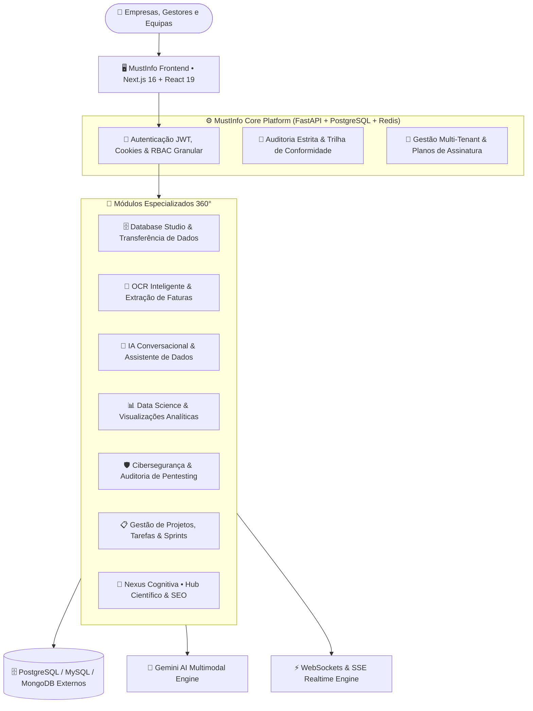
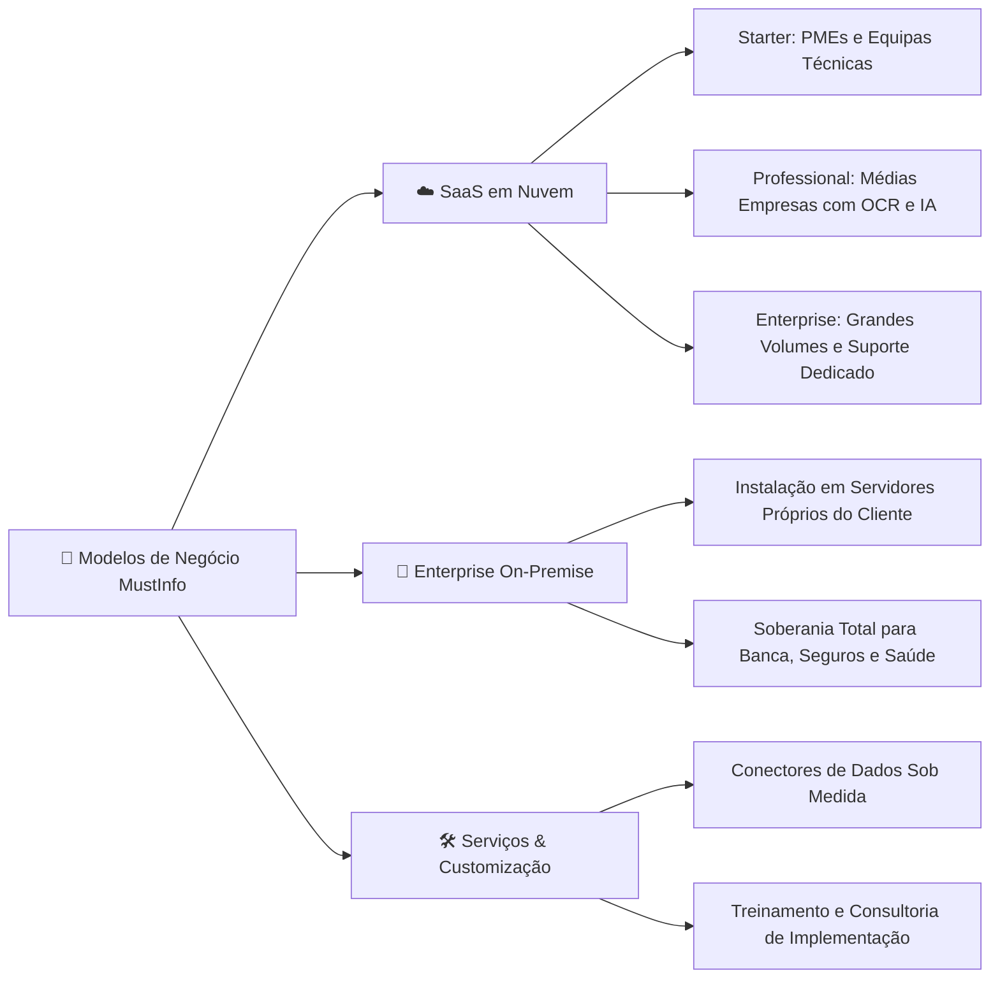

# 🚀 MustInfo — Plataforma Unificada de Gestão de Dados, Inteligência Artificial e Conhecimento

> **Documento Executivo de Apresentação de Negócio (Visão 360°)**  
> **Versão:** 2.0 • **Classificação:** Comercial & Estratégico • **Ecossistema:** MustInfo / Nexus Cognitiva  

---

## 1. Sumário Executivo (Executive Summary)

O **MustInfo** é uma plataforma corporativa integrada de **Governança de Dados, Engenharia de Banco de Dados, Inteligência Artificial Multimodal e Gestão do Conhecimento**.

Historicamente, as empresas precisam de contratar e gerir **4 a 6 ferramentas separadas** para operar o seu dia-a-dia tecnológico:
1. Um gestor de base de dados (ex: DBeaver, pgAdmin);
2. Uma ferramenta de extração documental e OCR;
3. Um assistente corporativo de IA desconectado dos dados reais;
4. Uma ferramenta de gestão de tarefas e sprints (ex: Jira, Trello);
5. Uma base de conhecimento ou wiki interna (ex: Notion, Confluence);
6. Ferramentas de auditoria de segurança e diagnóstico de desempenho.

O **MustInfo unifica todas estas verticais num único ecossistema seguro, modular e multi-tenant**, reduzindo custos de licenciamento, eliminando silos de informação e garantindo auditoria ponta a ponta.

---

## 2. O Problema de Mercado vs. A Solução MustInfo

| O Desafio Atual das Empresas | A Solução Entregue pelo MustInfo |
| :--- | :--- |
| **Silos de Dados Fragmentados:** Bases de dados isoladas que exigem equipas dedicadas só para extrair relatórios. | **Database Studio Unificado:** Acesso seguro, consultas visuais, streaming de grandes volumes e histórico com auditoria. |
| **Quedas de Servidor por Queries Pesadas:** Consultas sem índice e transferências cegas geram Sequential Scans que travam o banco de clientes. | **Dry-Run & Impact Predictor (Estilo BigQuery):** Simulação de custo e tempo pré-execução, bloqueio proativo de queries de risco e sugestão de índices em 1 clique. |
| **Processamento Manual de Faturas e Documentos:** Horas perdidas a digitar dados de PDFs, faturas e tabelas digitalizadas. | **OCR Multimodal Inteligente:** Extração instantânea de texto e tabelas em PDFs/imagens com análise orientada por LLM (Gemini AI). |
| **Custos Excessivos com Múltiplos Softwares:** Licenças em dólares para Jira, DBeaver EE, softwares de OCR e wikis. | **All-in-One Cost Efficiency:** Plataforma única com multi-tenancy, planos ajustáveis e compressão FinOps de tráfego de rede. |
| **Falta de Segurança e Risco de Vazamentos:** Utilizadores usam IAs públicas expondo dados confidenciais de clientes. | **IA Segura com Soberania:** Assistente corporativo fechado, RBAC estrito e auditoria estrita de cada ação realizada. |
| **Perda do Conhecimento Institucional:** Metodologias e estudos perdem-se em pastas partilhadas. | **Nexus Cognitiva:** Hub de conhecimento colaborativo com rigor metodológico, SEO de topo e sincronização em tempo real. |

---

## 3. Visão 360° do Ecossistema MustInfo



---

## 4. Detalhamento dos 7 Módulos de Negócio

### 🗄️ Módulo 1: Database Studio & Motor de Transferência de Dados
* **Multi-Database Support:** Conexão nativa e transparente a PostgreSQL, MySQL, MongoDB e outras fontes.
* **SQL Studio Interativo:** Editor com realce sintático, autocompletion inteligente e execução segura.
* **🛡️ Dry-Run & Query Impact Predictor (Inspirado no Google BigQuery):** Avaliação de custo, linhas estimadas e detecção automática de `Sequential Scan` (SQL) ou `COLLSCAN` (MongoDB) **antes** de executar. Bloqueia comandos arriscados e gera comandos `CREATE INDEX` com 1 clique.
* **Transferência Heterogênea de Dados por Query:** Migração transacional entre PostgreSQL, MySQL, MongoDB e SQLite com construtor visual de queries e preview com amostragem.
* **Streaming de Resultados:** Capacidade de transmitir milhões de linhas sem estourar a memória do navegador através de SSE (*Server-Sent Events*).
* **Monitor de Deadlocks em Tempo Real:** Deteção proativa de bloqueios no banco de dados com opção de terminar conexões problemáticas com um clique.
* **Transferência Segura de Dados:** Migração e sincronização entre tabelas e bases de dados com garantia transacional.
* **Histórico Completo de Queries:** Registo de tempo de resposta, quantidade de linhas afetadas e autoria de cada comando executado.

### 📄 Módulo 2: OCR Inteligente & Extração Multimodal de Documentos
* **Digitalização de Faturas, Relatórios e Balanços:** Carregamento de imagens e ficheiros PDF complexos.
* **Extração Estruturada:** Transformação automática de tabelas digitalizadas em formatos manipuláveis (Excel, JSON).
* **Análise Semântica por IA:** O sistema não apenas lê o texto, mas interpreta valores, datas de vencimento, NIF/CNPJ e discrepâncias fiscais.

### 🤖 Módulo 3: Assistente de Inteligência Artificial Conversacional
* **Chat Integrado ao Contexto Corporativo:** Permite aos colaboradores formular perguntas em linguagem natural (ex: *"Qual o total faturado no último trimestre?"*).
* **Privacidade e Governança:** Consultas executadas dentro do perímetro seguro da empresa, sem expor dados confidenciais a provedores públicos abertos.

### 📊 Módulo 4: Data Science & Engenharia de Dados
* **Dashboards em Tempo Real:** Métricas de desempenho operacional, contagens de tabelas e fluxos de dados.
* **Análise Exploratória:** Ferramentas para cientistas de dados inspecionarem padrões, correlações e anomalias nos dados corporativos.
* **Geração Automatizada de Relatórios:** Exportação com um clique para PDF profissional (via WeasyPrint) e folhas de cálculo Excel.

### 🛡️ Módulo 5: Cibersegurança, Auditoria & Pentesting
* **Módulo de Pentest Integrado:** Testes automáticos de segurança e integridade em endpoints e estruturas de dados.
* **Strict Audit Middleware:** Sanitização automática de palavras-passe e segredos nas trilhas de auditoria para conformidade rigorosa (LGPD / RGPD).
* **Modo Manutenção e Proteção de Sistema:** Capacidade de isolar serviços para manutenção mantendo rotas vitais de emergência ativas.

### 📋 Módulo 6: Gestão Ágil de Projetos, Tarefas e Sprints
* **Gestão Ágil Completa:** Criação e monitorização de Projetos, Sprints e Tarefas com estados personalizáveis.
* **Rastreabilidade de Entregas:** Associação direta de tarefas a comandos de dados ou projetos de engenharia.
* **Métricas de Produtividade:** Acompanhamento do tempo de execução, atrasos e atribuição de responsabilidades.

### 🧠 Módulo 7: Nexus Cognitiva (Hub de Conhecimento Colaborativo)
* **Repositório de Conhecimento Fundamentado:** Espaço aberto ou restrito para partilha de estudos científicos, relatórios técnicos e experiências metodológicas.
* **SEO e Indexação Ultrarrápida:** Arquitetura Server-Side Rendering (SSR) com Schema.org JSON-LD, `sitemap.xml` dinâmico e `robots.txt` para posicionamento no topo do Google.
* **Interatividade em Tempo Real:** WebSockets para contagem de leitores simultâneos, reações imediatas, notificações flutuantes e comentários colaborativos.
* **Gestão Multidomínio:** Suporte total para operar sob o domínio corporativo principal (`mustainfo.org/nexus-cognitiva`) ou sob um **domínio dedicado independente** (ex: `nexuscognitiva.com`).

---

## 5. Roteiro Passo a Passo de Apresentação de Negócio (Pitch Script)

Para reuniões com Diretores de Tecnologia (CTO), Diretores de Operações (COO), CEOs ou Investidores, utilize a seguinte estrutura de **25 a 30 minutos**:

```mermaid
timeline
    title Estrutura da Apresentação Executiva
    00:00 - 03:00 : 1. Abertura & Dor de Mercado
    03:00 - 07:00 : 2. O Diagnóstico de Custos
    07:00 - 18:00 : 3. Demonstração Prática 360°
    18:00 - 22:00 : 4. Segurança & Governança
    22:00 - 26:00 : 5. Estudo de ROI & Monetização
    26:00 - 30:00 : 6. Conclusão & Próximos Passos
```

### ⏱️ Passo 1: Abertura e Gancho de Impacto (3 min)
* **Objetivo:** Captar a atenção imediata através de uma dor real do cliente.
* **O que dizer:**
  > *"Hoje, a maioria das empresas gasta dezenas de milhares de euros por ano mantendo 5 softwares diferentes para gerir bases de dados, digitalizar documentos com OCR, gerir tarefas e documentar conhecimento. Além do custo, os dados ficam espalhados e sem auditoria centralizada. O MustInfo nasceu para resolver exatamente essa dor: uma plataforma única que centraliza inteligência de dados, IA documental e gestão do conhecimento em ambiente seguro."*

### ⏱️ Passo 2: O Diagnóstico de Custos e Risco (4 min)
* **Objetivo:** Mostrar o prejuízo invisível da fragmentação.
* **Apresentar:**
  * O custo acumulado de licenças isoladas (DBeaver EE + Jira + Confluence + Softwares de OCR).
  * O risco de segurança quando colaboradores utilizam ferramentas externas sem controle de acessos (RBAC).
  * A perda de tempo operacional em tarefas manuais de extração de dados.

### ⏱️ Passo 3: Demonstração Prática da Solução 360° (11 min)
Mostre o sistema em funcionamento real com 3 cenários de elevado valor visual:
1. **Cenário 1 — Gestão de Dados, Dry-Run & Automação:**
   * Abrir o **Database Studio** e mostrar a listagem de conexões heterogêneas.
   * Digitar uma consulta de alto volume e clicar em **Explain / Avaliar Impacto**: demonstrar o **Dry-Run** detectando um Sequential Scan, estimando linhas/custo e gerando o `CREATE INDEX` em 1 clique.
   * Demonstrar o **Impact Guard** interceptando uma operação arriscada com modal de confirmação consciente.
   * Executar uma consulta e demonstrar o **streaming de dados em tempo real** sem lentidão.
   * Abrir o **Monitor de Deadlocks** demonstrando a saúde proativa da base de dados.
2. **Cenário 2 — Inteligência Documental (OCR + IA):**
   * Fazer o upload de uma fatura ou relatório em PDF/imagem.
   * Mostrar a extração estruturada dos dados em segundos através da IA Gemini.
3. **Cenário 3 — Conhecimento e Notificações (Nexus Cognitiva):**
   * Entrar na plataforma de conhecimento **Nexus Cognitiva**.
   * Mostrar o SEO pronto para o Google e a sincronização via WebSocket (uma publicação ou comentário gerando notificação instantânea para os utilizadores conectados).

### ⏱️ Passo 4: Segurança, Auditoria e Soberania de Dados (4 min)
* **Objetivo:** Quebrar as objeções do departamento de TI e Compliance.
* **Pontos Chave:**
  * Multi-tenancy com isolamento completo por empresa (`empresa_id`).
  * Trilha de auditoria rigorosa (*Strict Audit Middleware*) registando quem alterou o quê.
  * Otimização FinOps: compressão GZip nativa reduzindo drasticamente os custos de tráfego de dados (*egress*).

### ⏱️ Passo 5: Estudo de ROI e Proposta de Valor Comercial (4 min)
* **Objetivo:** Provar que a plataforma se paga a si mesma.
* **Apresentar os números:**
  * **60% de redução** em custos com ferramentas dispersas.
  * **80% de aceleração** no processamento e reconciliação de faturas via OCR.
  * **Zero risco** de perda de dados críticos com o monitor de deadlocks e backups.

### ⏱️ Passo 6: Fecho e Próximos Passos Comerciais (4 min)
* **Chamada para Ação:**
  * Agendar um piloto (*Proof of Concept* - PoC) de 14 dias numa base de dados ou departamento do cliente.
  * Levantamento das conexões de banco de dados e fluxos de documentos do cliente.

---

## 6. Modelos de Comercialização & Monetização

O MustInfo foi desenhado para suportar modelos de receita escaláveis:



---

## 7. Comparativo Competitivo de Mercado

| Recurso / Funcionalidade | Ferramentas Tradicionais (DBeaver / Jira / Notion) | Soluções Isoladas de OCR | **MustInfo 360°** |
| :--- | :---: | :---: | :---: |
| **SQL Studio & Streaming** | Sim (DBeaver) | Não | **Sim (Integrado)** |
| **Monitorização de Deadlocks** | Não (Requer Scripts) | Não | **Sim (Automático)** |
| **OCR Multimodal com IA** | Não | Sim (Caro) | **Sim (Nativo com Gemini)** |
| **Trilha de Auditoria Rigorosa** | Parcial | Não | **Sim (Conforme LGPD/RGPD)** |
| **Gestão de Tarefas & Sprints** | Sim (Jira separado) | Não | **Sim (Centralizado)** |
| **Hub Científico com SEO (Nexus)** | Não | Não | **Sim (Com Domínio Próprio)** |
| **Custo Consolidado** | Alto ($$$) | Alto ($$$) | **Otimizado e Único ($)** |

---

## 8. Checklist de Preparação para Reuniões de Negócio

Antes de entrar na reunião de apresentação com um lead comercial:
- [ ] Verificar se os serviços backend (`uvicorn`) e frontend (`Next.js`) estão ativos.
- [ ] Ter pelo menos 1 documento de exemplo (fatura ou relatório) pronto para demonstração de OCR.
- [ ] Confirmar que o utilizador de demonstração possui perfil de Administrador com acesso a todos os módulos.
- [ ] Demonstrar a experiência fluida no **Nexus Cognitiva** com o sino de notificações e pesquisa rápida.
- [ ] Apresentar a flexibilidade de implantação (Nuvem ou On-Premise) consoante as exigências do cliente.
